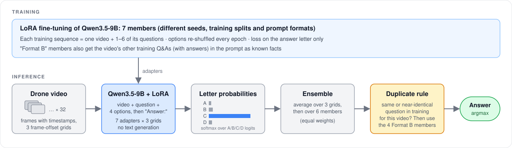
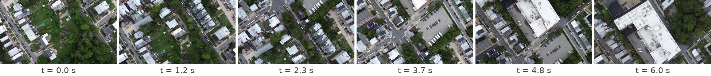
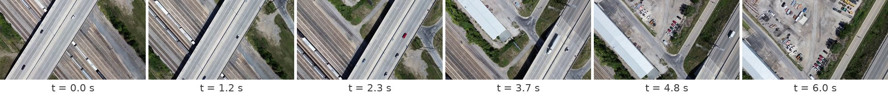

# ReVA Drone Video QA

This project answers multiple-choice questions about drone videos with a fine-tuned Qwen3.5-9B. It was built for the
**ReVA Drone Video Understanding Challenge** (MAVU @ WACV 2027), where it scores **0.8775 accuracy on the 4,000-question
test set**. It uses open-weight models only.



## How it works

- **Input:** the question, its four options, and 32 frames sampled from the video. The frames carry their real times, one
  time tag per pair of frames.
- **Model:** Qwen3.5-9B with LoRA adapters on the language model; the vision encoder stays frozen.
- **Answer:** the model never writes text. It reads the prompt once, and the answer is the letter (A–D) with the highest
  probability.
- **Training:**
  - Each training sequence packs one video with several of its questions.
  - The options are shuffled every epoch.
  - The loss is computed on the answer letter only.
- **Ensemble:** 6 adapters, which differ in random seed and training split. Each adapter runs on 3 slightly shifted frame
  samplings, and all the probabilities are averaged.
- **Known facts ("Format B"):** some adapters also get the video's other training questions, with their answers, in the
  prompt. If a test question repeats a training question about the same video, its answer comes from these adapters.

## Examples

Here are two questions from our dev split, which was taken from the ReVA training set. Each strip shows 6 of the 32 input
frames. The percentages are the model's probabilities, from adapters that never saw these questions in training.

**Q: At what point in the video does the large building with a flat roof first appear in the frame?**



| A. At 5.5 seconds | B. At 7.0 seconds | **C. At 4.0 seconds** ✅ | D. At 2.5 seconds |
|:-:|:-:|:-:|:-:|
| 0.1% | <0.1% | **99.4%** | 0.4% |

**Q: What is the most likely reason for the elevated highway structure crossing over the railroad tracks?**



| A. To prevent traffic congestion at the intersection | B. To avoid the need for traffic signals at the crossing | C. To provide a scenic view for drivers | **D. To allow trains to pass underneath without stopping traffic** ✅ |
|:-:|:-:|:-:|:-:|
| <0.1% | <0.1% | <0.1% | **99.9%** |

This is the full prompt for the first example. The video placeholder is replaced by the frames and their time tags:

```text
<|im_start|>system
You are watching a drone video. Answer the multiple-choice question with only the letter.<|im_end|>
<|im_start|>user
<|vision_start|><|video_pad|><|vision_end|>Question: At what point in the video does the large building with a flat roof first appear in the frame?
A. At 5.5 seconds
B. At 7.0 seconds
C. At 4.0 seconds
D. At 2.5 seconds
Answer:<|im_end|>
<|im_start|>assistant
<think>

</think>

```

## Quick start

You need one 32 GB GPU and about 30 GB of disk. On an RTX 5090, prediction takes about 5.5 h and training about 70 h.

```bash
python3.11 -m venv .venv && source .venv/bin/activate
pip install -r requirements.txt
./setup_data.sh   # downloads the dataset and base model, caches frames, builds splits
./predict.sh      # runs the adapters, ensembles them, writes submission.zip
```

**Adapters.** `predict.sh` needs the seven trained adapters. Download the `<member>.tar` files from the
[v1.0 release](../../releases/tag/v1.0) into the repository folder, then unpack them:

```bash
for m in final_9b_formatB final_9b_plain run1_9b run5_9b_formatB s13_9b_plain s12_9b_formatB s14_9b_formatB; do
  mkdir -p weights/$m/epoch_2 && tar -xf $m.tar -C weights/$m/epoch_2
done
```

To train the adapters yourself instead, run `./train.sh`, then `WEIGHTS=ckpt ./predict.sh`. Retrained adapters will not be
bit-identical to the released ones. The released `run1_9b` was also trained with an earlier `train.py` that took one
fewer optimizer step (3,623 instead of 3,624).

## Project structure

```text
setup_data.sh               download data and base model, cache frames, build splits
train.sh                    train the 7 LoRA adapters
predict.sh                  inference, ensemble, repeated-question rule, submission.zip
scripts/
  download.py               dataset and base model (pinned revision)
  cache_frames.py           32 frames x 3 samplings per video, with timestamps
  make_dev.py               dev and training splits
  reva_common.py            prompt template and data helpers (shared by training and inference)
  train.py                  LoRA fine-tuning
  eval_probs.py             answer-letter probabilities
  ensemble_members.py       average the adapters
  dup_override.py           repeated-question rule (exact repeats)
  neardup_override.py       repeated-question rule (near repeats)
  make_submission.py        Codabench submission file
assets/                     pipeline figure and example frames
```

## Data

This repository contains no ReVA videos or annotation files. `setup_data.sh` downloads them from the official
[ReVA dataset on Hugging Face](https://huggingface.co/datasets/ReVA-Benchmark/ReVA). Use of the data is governed by the
dataset card (Apache-2.0) and the ReVA challenge terms.

## License

The code is released under the [MIT License](LICENSE). The ReVA data and the Qwen3.5-9B base model keep their own licenses.
